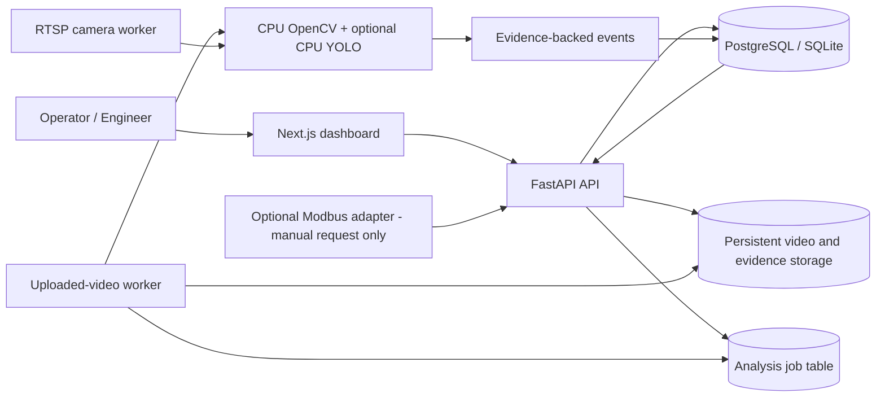

# LineGuard CV v0.2

**CPU-first assembly inspection, surface-defect screening and live manufacturing monitoring platform**

LineGuard CV is a local-first, evidence-first industrial computer-vision platform foundation. It provides organization-scoped stations, explicit inspection rules, uploaded-video jobs, RTSP/webcam sampling worker, evidence-backed events, operator review, CPU surface-defect heuristics, optional CPU YOLO inference/training, benchmark tooling, Modbus TCP integration boundary, reports and a Charcoal + Copper web dashboard.

> **Scope and safety notice:** This release combines deterministic OpenCV heuristics with an optional user-supplied YOLO model adapter. The surface-defect heuristic only identifies scratch/crack-like image candidates; it is not a trained/validated crack classifier. YOLO needs your own labeled dataset and weights. A clean result does not prove a product is defect-free. The PLC adapter defaults to simulation and output-disabled mode; detections never automatically stop machinery. It is not a safety PLC, emergency stop, certified protective function or factory certification.

## What is included in v0.2

- FastAPI backend with OpenAPI docs at `/docs`, SQLAlchemy and Alembic migrations.
- Organization-scoped authorization, Scrypt password hashing, signed HttpOnly sessions, CSRF protection, login rate limiting and audit logs.
- Site, station, camera, inspection-rule and model-provider management APIs.
- Validated video uploads, bounded CPU frame sampling, persistent job queue and analysis worker.
- CPU OpenCV HSV color-presence and motion-stall heuristics.
- CPU OpenCV scratch/crack-like surface candidate detection using background suppression, morphology and connected components.
- Optional Ultralytics YOLO inference pinned to `device="cpu"`; accepts user-supplied weights, supports object-detection and class-absence rules.
- RTSP/RTSPS and local-webcam camera capture service with reconnects, health status, frame sampling and live evidence-backed events.
- Event review lifecycle, evidence storage, CSV export and reporting for both uploaded-video and live-camera events.
- Optional Modbus TCP PLC adapter with connection testing, safe simulation default, output disabled by default and an explicitly confirmed manual stop-request bit boundary.
- CPU YOLO dataset validation, CPU training script and box precision/recall/F1 + latency benchmark utility.
- Next.js App Router dashboard, sign-in screen, video analysis workspace, events, stations/rules, reports and camera/PLC integrations.
- Docker Compose for web, API, uploaded-video worker, live-camera worker and PostgreSQL.
- Pytest coverage for API, auth, authorization, tenant isolation and analysis workflow.

## Included functionality vs. production validation

| Feature | Included implementation | Production validation still required |
|---|---|---|
| Video-based inspection | Yes, uploaded clips | Target codec, camera, lighting and throughput |
| HSV color detection | Yes, deterministic ROI rule | SKU/lighting-specific threshold validation |
| Motion stall detection | Yes, frame-difference estimate | Compare to trusted machine telemetry |
| YOLO object detection | Optional CPU adapter | Supply weights, label target data and benchmark |
| Scratch/crack detection | CPU morphology candidate heuristic | Train/validate a defect-specific model for real use |
| RTSP live camera | Camera worker and health APIs | Network, reconnect and multi-camera load tests |
| PLC integration | Optional Modbus TCP adapter | Commission dedicated PLC request bit and verify fail-safes |
| Machine-stop request | Manually confirmed momentary request only | Plant controls/safety approval; independent machine protection |
| Custom defect-model training | CPU YOLO training script | Curated labels, dataset splits, reproducibility and model approval |
| Industrial accuracy benchmark | Benchmark script and reporting plan | Real blind holdout and target CPU performance report |
| Factory safety certification | Not supplied | Independent risk assessment and formal certification process |

## Not included / not claimed

- No YOLO weights, proprietary datasets or trained defect model are bundled.
- No guaranteed part identity, assembly sequence correctness or defect-free decision.
- No automatic machine stop triggered by AI detections.
- No direct motor/actuator control, emergency-stop circuit, safety relay, safety PLC, robotics control or certified safety function.
- No measured industrial precision/recall, FPS, throughput or production uptime claim.
- No factory safety certification or regulatory conformity claim.
- PLC hardware writes are disabled by default and must be commissioned on a dedicated request bit by qualified controls/safety personnel.

## Architecture



The database-backed queue is deliberately simple. SQLite is intended for local development and a single worker; PostgreSQL is the preferred Compose deployment target. A separate worker handles analysis so long-running video processing is not tied to an HTTP request.

## Requirements

### Option A: Docker Compose

- Docker Desktop / Docker Engine with Compose plugin.
- Approximately 4 GB free memory recommended for a small local trial; actual needs depend on the video and worker settings.
- A CPU is enough for the baseline. GPU support is not required.

### Option B: Native development

- Python 3.11 or newer.
- Node.js 22 or another supported Node.js version compatible with the pinned Next.js release.
- PostgreSQL optional; SQLite is the default local database.
- OpenCV-readable video, e.g. a supported MP4 or AVI.
- RTSP cameras reachable from the worker host if using live monitoring.
- Optional: a locally stored YOLO checkpoint and CPU training dependencies.

## Quick start with Docker

1. Copy `.env.example` to `.env`.
2. Change `POSTGRES_PASSWORD` and `SECRET_KEY` before any remote deployment. The defaults are development-only.
3. Build and start the stack:

   ```bash
   docker compose up --build -d
   docker compose ps
   docker compose logs -f api worker camera-worker web
   ```

4. Create the first owner account:

   ```bash
   docker compose exec api python -m app.cli create-admin \
     --email admin@example.com \
     --password 'replace-with-a-long-unique-password' \
     --organization 'My Manufacturing Plant'
   ```

   Use a unique password of at least 12 characters. This command creates an owner account. In a fresh Compose setup, the API first applies the Alembic migrations.

5. Open `http://localhost:3000` and sign in. API documentation is at `http://localhost:8000/docs`.

6. Create a site, then a station, then an inspection rule. Upload a short video and start an analysis. The worker must be running for queued jobs to complete.
7. Open **Integrations** to register RTSP/webcam sources and test the camera. The separate `camera-worker` service processes live frames.
8. PLC mode defaults to simulation and output disabled. Do not enable hardware writes before reviewing [PLC safety boundary](docs/plc-and-machine-control.md).

Stop the stack with `docker compose down`. Persistent database and video/evidence data remain in named volumes. **Do not use `docker compose down -v` unless you intentionally want to delete those volumes.**

## Native development

From the repository root:

```bash
# Backend (PowerShell examples work with a venv activated first)
cd backend
python -m venv .venv
# Windows PowerShell: .\.venv\Scripts\Activate.ps1
# macOS/Linux: source .venv/bin/activate
pip install -e '.[dev]'
python -m app.cli init-db
python -m app.cli create-admin --email admin@example.com --password 'replace-with-a-long-unique-password' --organization 'My Plant'
uvicorn app.main:app --reload --port 8000
```

Open a second terminal and run the worker from `backend` with the same environment and database configuration:

```bash
python -m app.cli worker
```

Open another terminal for RTSP live processing:

```bash
python -m app.cli camera-worker
```

Open a final terminal:

```bash
cd frontend
npm install
# Optional: create frontend/.env.local with NEXT_PUBLIC_API_BASE_URL=http://localhost:8000
npm run dev
```

Visit `http://localhost:3000`. Ensure the API's `CORS_ORIGINS` contains the exact local frontend origin. The browser uses an HttpOnly session cookie and a readable CSRF token cookie; mutating requests include the CSRF header. For live camera processing start a separate terminal with `python -m app.cli camera-worker`.

## Configure an inspection rule

### Example: look for a blue component in a station region

Create a station-specific `color_presence` rule:

```json
{
  "station_id": "<station UUID>",
  "name": "Blue component presence",
  "rule_type": "color_presence",
  "severity": "warning",
  "config": {
    "zone": [0.15, 0.15, 0.85, 0.85],
    "hsv_lower": [100, 80, 50],
    "hsv_upper": [130, 255, 255],
    "min_pixel_ratio": 0.015,
    "min_consecutive": 3
  }
}
```

The coordinates are normalized fractions of the image (`[x1, y1, x2, y2]`). HSV ranges use OpenCV's HSV scale. The heuristic raises a *potential missing component* event after the selected color remains below the configured ratio for the required number of sampled frames.

This rule only detects pixel colors. It does **not** confirm that a blue object is the correct part, orientation, size, SKU or assembly stage. Lighting, reflection, camera movement, nearby colored surfaces and occlusion can cause false positives and false negatives.

### Example: station inactivity heuristic

```json
{
  "station_id": "<station UUID>",
  "name": "Station appears inactive",
  "rule_type": "motion_stall",
  "severity": "warning",
  "config": {
    "inactivity_seconds": 5,
    "mean_difference_threshold": 2.0
  }
}
```

This compares sampled frames. A static camera view or a scene with naturally little motion can trigger it. It is not an authoritative machine-state signal.

## Advanced CPU features

See [CPU vision and training](docs/cpu-vision-and-training.md), [live cameras](docs/live-cameras.md), [PLC integration and safety boundary](docs/plc-and-machine-control.md), and [validation/benchmarking](docs/validation-and-benchmarking.md). The Integrations page also exposes camera registration, camera connection tests and PLC adapter status.

Optional dependencies:

```bash
cd backend
pip install -e '.[yolo-cpu]'   # Ultralytics + PyTorch CPU runtime for user-supplied YOLO weights
pip install -e '.[plc]'        # Modbus TCP adapter
# or both: pip install -e '.[industrial]'
```

For Docker, set `BACKEND_EXTRAS=industrial` in `.env` before `docker compose build` to include the optional packages. This significantly increases image size and build time; the default image stays lean and CPU-OpenCV-only.

## CPU settings

- `DEFAULT_FRAME_STRIDE=10`: run inspection every tenth decoded frame by default. Lower values sample more frequently but increase CPU time.
- `MAX_SAMPLED_FRAMES=1200`: upper bound on sampled frames per job.
- `MAX_UPLOAD_MB=200`: maximum uploaded-video size.
- `WORKER_POLL_SECONDS=1`: idle polling delay for the database queue.
- `LIVE_CAMERA_SAMPLE_SECONDS=1.0`: maximum analysis sampling cadence for each connected live camera.
- `LIVE_EVENT_DEDUPE_SECONDS=60`: minimum time between same-rule live alerts.
- `YOLO_MODEL_PATH`: optional path to a locally stored YOLO checkpoint.
- `PLC_MODE=simulation` and `PLC_OUTPUTS_ENABLED=false`: safe PLC defaults.

Performance must be measured on the target processor, video resolution, codec and rule configuration. No FPS claim is made for a generic machine. Only one worker should poll a SQLite database; use PostgreSQL for concurrent workers.

## Tests and quality checks

```bash
cd backend
pip install -e '.[dev]'
pytest -q
ruff check app tests
python -m compileall -q app tests
```

Frontend:

```bash
cd frontend
npm install
npm run typecheck
npm run lint
npm run build
```

CI runs Python tests and frontend lint/type/build steps. Actual results in this packaged environment are reported separately in `docs/validation-report.md`; commands that require unavailable external package downloads must be run in the deployment environment.

## Deployment notes

- For a remote deployment, use HTTPS and set `APP_ENV=production`, `COOKIE_SECURE=true`, a strong `SECRET_KEY`, a strong database password and exact frontend origins. Do not expose database ports publicly.
- Use `docker compose -f compose.yaml -f compose.production.yaml up --build -d` behind a properly configured TLS-terminating reverse proxy. The production overlay intentionally removes the default host port mappings.
- The default Compose frontend API URL assumes `http://localhost:8000`. For a production domain, set `NEXT_PUBLIC_API_BASE_URL` at build time to the HTTPS API origin and align CORS with the frontend origin.
- Configure reverse-proxy request-size limits and distributed rate limiting for internet-facing deployments. Application-level login throttling is in-memory and does not coordinate across multiple API processes.
- Back up PostgreSQL and `lineguard_data` together. Practice a restore before storing operational footage.
- Review licenses for any detector library, model weights and dataset before commercial distribution. The application core does not bundle YOLO or proprietary weights.

## API overview

All application endpoints use `/api/v1`; system endpoints are `/healthz`, `/readyz` and `/version`. FastAPI publishes OpenAPI docs at `/docs` and schema at `/openapi.json`.

See [API guide](docs/api.md), [architecture](docs/architecture.md), [database model](docs/database.md), [security](docs/security.md), [deployment](docs/deployment.md), [vision pipeline](docs/vision-pipeline.md), [CPU training](docs/cpu-vision-and-training.md), [live cameras](docs/live-cameras.md), [PLC boundary](docs/plc-and-machine-control.md), [benchmarking](docs/validation-and-benchmarking.md), [safety commissioning](docs/safety/commissioning-checklist.md) and [limitations](docs/limitations-and-validation.md).

## License

MIT; see [LICENSE](LICENSE). Third-party library, model and dataset licenses remain separate and must be respected.
