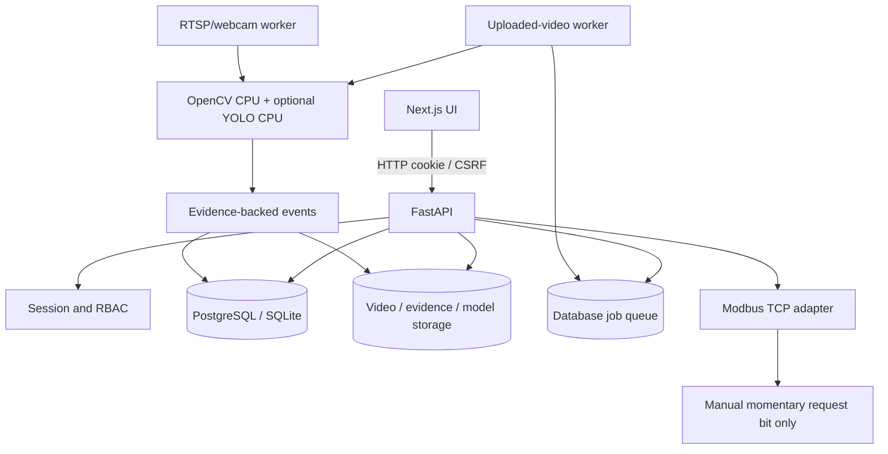

# Architecture

## Design principles

1. CPU-first modular monolith for API, with separate uploaded-video and live-camera worker processes.
2. PostgreSQL is the preferred metadata/job/event database. SQLite supports local development and a single uploaded-video worker; multiple camera threads may contend on SQLite writes.
3. Videos/evidence/model files live on persistent storage; database rows store storage keys and metadata.
4. Rules are explicit and versioned. OpenCV heuristics and optional user-supplied YOLO inference have separate limitations.
5. Findings are evidence-backed review records, not confirmed product defects or safety signals.
6. Tenant isolation is enforced at backend query boundaries.
7. PLC adapter is a separate integration boundary; AI events never initiate machine-stop requests.

## Components

## Workers

The uploaded-video worker claims one queued analysis job at a time and samples a bounded number of frames. The camera-worker discovers registered RTSP/webcam sources, opens streams with reconnect behavior, samples each source at a configured cadence, evaluates active station rules and persists live events. Live events use nullable video/job references and include camera identity in event details. Both flows share event review, evidence retrieval and audit records.

YOLO inference is optional and always requests CPU device. Weight paths are restricted to `YOLO_MODEL_ROOT`. Training is a separate offline script; it does not run inside the API. Model artifacts are user-managed and versioned.

## PLC boundary

The PLC adapter defaults to simulation and outputs disabled. Connection tests do not write. An authenticated, role-restricted, explicitly confirmed manual endpoint can issue a configured momentary PLC request bit only when an administrator has deliberately enabled it. No AI result triggers this endpoint. This is not a safety PLC, E-stop, relay or certified safety function.

## Scaling and failure boundaries

- Use PostgreSQL for multi-process/multi-camera deployment and coordinate evidence storage with database backups.
- Benchmark camera decode, CPU inference and event write load on the real host. Do not assume a fixed camera count/FPS.
- A missing optional model must report an analysis error; it must not silently return no detections.
- A camera outage is a monitoring outage, not evidence of a safe process.
- A stop-request acknowledgement is not proof that the machine stopped; verify independently.
